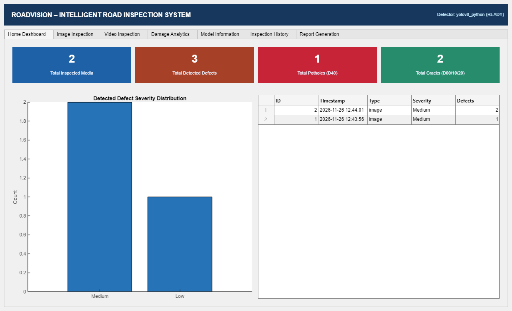
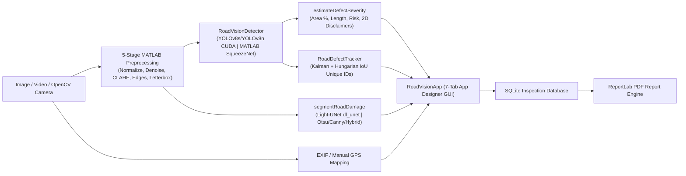
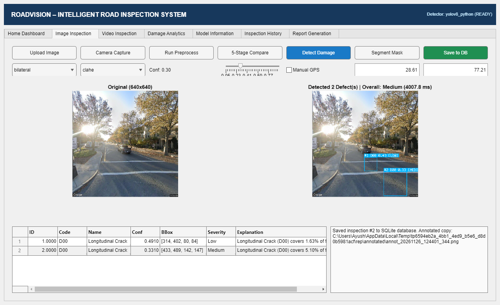
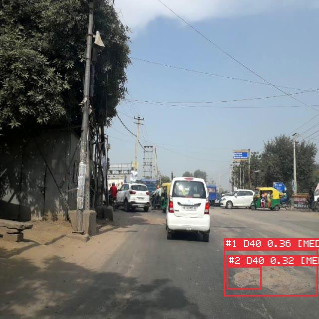
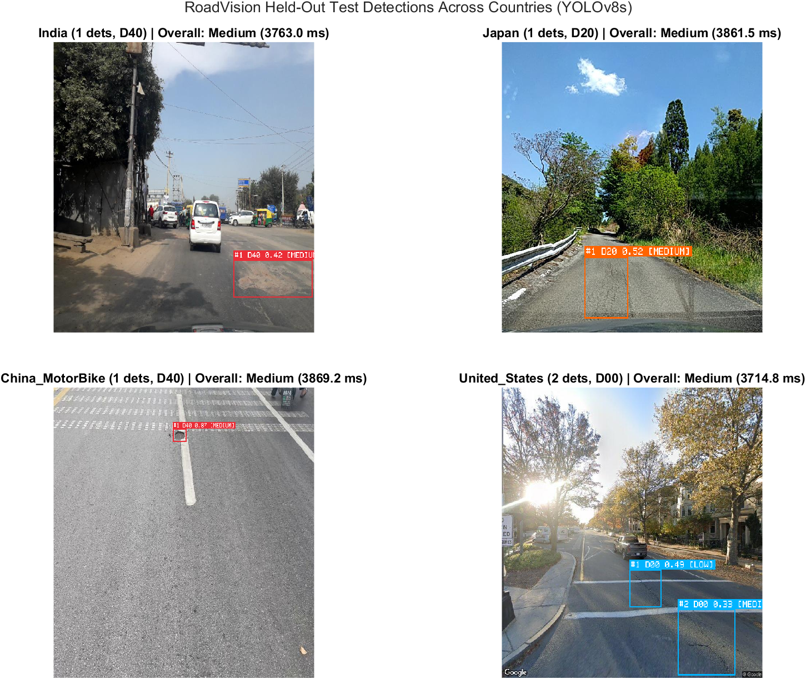
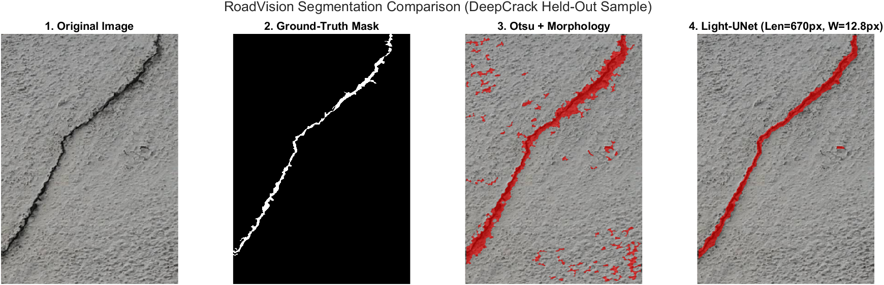
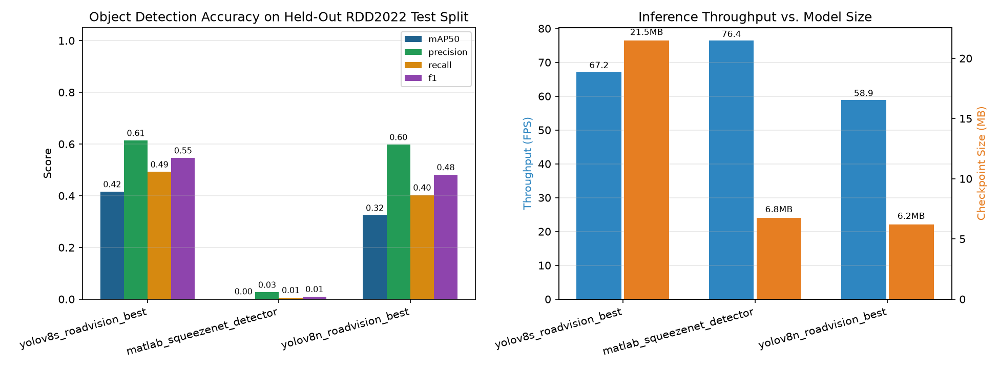
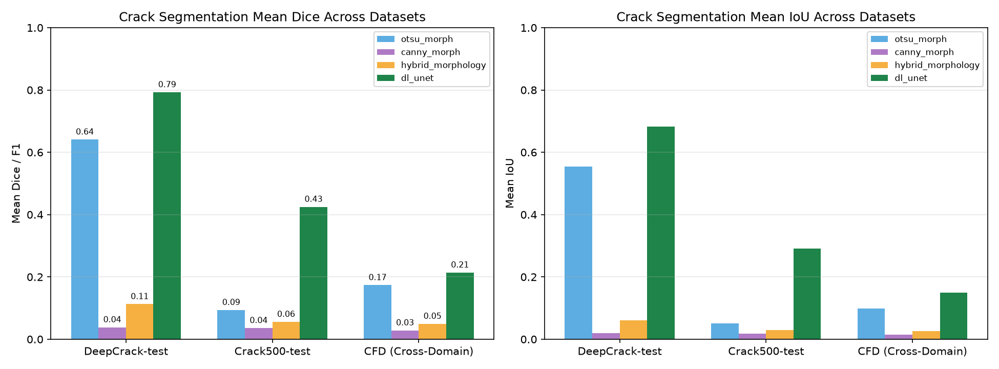

# RoadVision — Intelligent Road Damage Inspection System

RoadVision is an end-to-end **MATLAB R2024a** and **PyTorch CUDA** computer vision engineering platform for automated pavement distress detection, crack segmentation, severity estimation, multi-frame Kalman/Hungarian video defect tracking, GPS mapping, SQLite inspection persistence, PDF inspection reporting, and interactive 7-tab App Designer visualization.



---

## Key Features & Engineering Highlights

- **Multi-Country Pavement Damage Detection:** Detects and classifies 4 core RDD2022 surface distress classes (`D00` Longitudinal Crack, `D10` Transverse Crack, `D20` Alligator Crack, `D40` Pothole) across 7 countries (`47,420` total RDD2022 images, `38,384` deduplicated labels, `55,002` bounding boxes).
- **Dual Detection & Segmentation Architecture:**
  - **Primary Detector (`yolov8_python`):** **YOLOv8s** (`21.47 MB`, `67.22 FPS` GPU) & **YOLOv8n** (`6.20 MB`, `58.93 FPS` GPU / `20.70 FPS` CPU) trained with PyTorch `2.14.1+cu126` on NVIDIA RTX 4050 Laptop GPU.
  - **Native MATLAB Deep Learning Fallback:** Pure-MATLAB **SqueezeNet Grid Detector** (`6.75 MB`, `76.43 FPS`) and **3-Level Light-UNet (`dl_unet`)** crack segmenter (`1.58 MB`, `0.7927` Dice on `DeepCrack-test-50`, zero external dependencies).
- **5-Stage Vectorized MATLAB DIP Pipeline:** Pure M-code implementation of input normalization, spatial/bilateral denoising, CLAHE contrast enhancement, edge/morphology extraction, letterbox resize, and bounding-box-preserving augmentation ([comparePreprocessingStages.m](src/matlab/preprocessing/comparePreprocessingStages.m)).
- **Video Defect Tracking (Deduplicated Counts):** Combines `vision.KalmanFilter` constant-velocity prediction and Hungarian IoU assignment ([RoadDefectTracker.m](src/matlab/video/RoadDefectTracker.m)) to run at **`13.46 FPS` end-to-end**, collapsing `25` frame-level detections into `3` unique physical road defects.
- **Severity Assessment & Monocular Honesty:** Computes bounding-box coverage ratio, skeleton crack length/width, confidence-weighted Low/Medium/High/Critical risk scores, and plain-English engineering explanations — explicitly disclosing that 2D RGB images do not measure physical depth in millimeters.
- **Persistence, GPS & Automated PDF Reporting:** SQLite WAL inspection logging ([RoadVisionDatabase.m](src/matlab/database/RoadVisionDatabase.m)), EXIF/manual GPS geospatial rendering, batch image upload, and zero-warning multi-page ReportLab PDF generation ([generate_pdf_report.py](scripts/generate_pdf_report.py)).
- **Windows 11 Smart App Control Resilient:** Bypasses blocked built-in MEX binaries (`pyenv`, `images_builtins`, `mlreportgen_dom`, `matlabunit`) cleanly via pure vectorized MATLAB M-code and isolated subprocess bridges.

---

## System Architecture



---

## Desktop Application Showcase

| Image Inspection Tab (Multi-Class Detection + Severity Table) | Video Defect Tracking (`13.46 FPS`, Track IDs) |
| :---: | :---: |
|  |  |

| Held-Out Multi-Country Test Detections (`YOLOv8s`) | Crack Segmentation Samples (`DeepCrack`, `Crack500`) |
| :---: | :---: |
|  |  |

---

## Verified Quantitative Benchmarks

### 1. Held-Out RDD2022 Object Detection (`3,846` Test Images @ `conf = 0.25`)

| Model | Size (MB) | `test` mAP@0.5 | `test` mAP@0.5:0.95 | Precision | Recall | F1 | GPU ms/img | GPU FPS | CPU FPS |
| :--- | :---: | :---: | :---: | :---: | :---: | :---: | :---: | :---: | :---: |
| **YOLOv8s (`18` ep)** | `21.47` | **`0.4155`** | **`0.2164`** | **`0.6136`** | **`0.4920`** | **`0.5461`** | `14.88` | `67.22` (`67.65`*) | `9.33`* |
| **YOLOv8n (`10` ep)** | `6.20` | `0.3242` | `0.1618` | `0.5976` | `0.4026` | `0.4811` | `16.97` | `58.93` (`65.29`*) | **`20.70`**\* |
| **MATLAB SqueezeNet** (`10` ep, `1k` test) | `6.75` | `0.0010` | — | `0.0266` | `0.0059` | `0.0097` | **`13.08`** | **`76.43`** | — |

*\*Hardware comparison (`RTX 4050` GPU vs. CPU) measured across 30 India test images. Note: Ultralytics training `val` (`5,754` imgs, default PR sweep `conf=0.001`) reached `mAP@0.5 = 0.524` (`YOLOv8s`) and `0.444` (`YOLOv8n`).*



### 2. Pixel-Level Crack Segmentation (`50` Held-Out Test Images Each)

| Dataset | Method | Mean IoU | Mean Dice / F1 | Runtime (ms/img) |
| :--- | :--- | :---: | :---: | :---: |
| **DeepCrack-test-50** | **`dl_unet` (MATLAB Light-UNet)** | **`0.6819`** | **`0.7927`** | **`394.2`** |
| **DeepCrack-test-50** | `otsu_morph` | `0.5541` | `0.6410` | `646.5` |
| **Crack500-test-50** (`max_work_dim=800`) | **`dl_unet` (MATLAB Light-UNet)** | **`0.2910`** | **`0.4250`** | **`530.0`** |
| **Crack500-test-50** (`max_work_dim=800`) | `otsu_morph` | `0.0508` | `0.0939` | `1,296.0` |
| **CFD-50** (Unseen Cross-Domain) | **`dl_unet` (MATLAB Light-UNet)** | **`0.1489`** | **`0.2141`** | **`191.3`** |



### 3. Automated Verification Status

- **MATLAB Suite:** `25 / 25 PASS` (`7/7` `TestCoreAndPreprocessing`, `9/9` `TestEngineModules`, `9/9` `TestEndToEndScenarios`)
- **Python Suite:** `7 / 7 PASS` (`tests/python/test_annotation_and_audit.py`, `tests/python/test_edge_cases.py`)
- **Total:** **`32 / 32 PASS`**

---

## Repository Layout

```text
ROADVISION/
├── config/
│   ├── classes.json              # Extensible D00/D10/D20/D40 taxonomy & colors
│   └── roadvision_config.json    # Paths, preprocessing, thresholds, DB & PDF config
├── docs/
│   ├── DATASET_REGISTER.md       # Audited dataset inventory & provenance
│   ├── DEVELOPER_GUIDE.md        # Module contracts, conventions & extension guide
│   ├── DEVELOPMENT_PROGRESS.md   # Phase 1–18 execution tracker
│   ├── PROJECT_REPORT.md         # Full 21-section technical engineering report
│   └── assets/                   # Benchmark charts, confusion matrix & UI screenshots
├── scripts/
│   ├── download_datasets.py      # Reproducible dataset downloader & extractor
│   ├── audit_datasets.py         # MD5/dHash deduplication & leakage-free splitter
│   ├── convert_annotations.py    # VOC XML <-> YOLO TXT / COCO JSON converter
│   ├── train_yolov8.py           # Deterministic YOLOv8 training & ONNX exporter
│   ├── evaluate_models.py        # Held-out test evaluator + latency benchmarking
│   ├── evaluate_scenarios.py     # Multi-country, negative-safety & blur stress suite
│   ├── infer_yolov8.py           # Subprocess inference worker for MATLAB bridge
│   ├── generate_pdf_report.py    # ReportLab PDF inspection report generator
│   └── demo_roadvision_e2e.m     # End-to-end showcase & video verification script
├── src/matlab/
│   ├── startup_roadvision.m      # Adds MATLAB modules to session path
│   ├── core/                     # loadConfig, ClassRegistry, RoadVisionLogger, VOC loader
│   ├── preprocessing/            # Pure-MATLAB vectorized 5-stage DIP pipeline
│   ├── detection/                # RoadVisionDetector, annotateDetections, SqueezeNet trainer
│   ├── segmentation/             # Light-UNet (dl_unet), Otsu/Canny/Hybrid, rvBinaryOps
│   ├── severity/                 # estimateDefectSeverity (area/length/risk/disclaimers)
│   ├── video/                    # RoadDefectTracker (Kalman + Hungarian), processRoadVideo
│   ├── gps/                      # EXIF extraction, manual validation, geo scatter plotting
│   ├── database/                 # RoadVisionDatabase (SQLite CRUD, WAL, integrity, backup)
│   ├── reporting/                # generateInspectionPdf MATLAB wrapper
│   └── app/                      # 7-tab RoadVisionApp GUI
└── tests/
    ├── matlab/                   # TestCoreAndPreprocessing, TestEngineModules, TestEndToEndScenarios
    └── python/                   # pytest annotation, audit & edge-case tests
```

---

## Setup & Usage

> **Note on Large Binaries:** Raw/processed datasets (`~16+ GB`), trained model weights (`*.pt`, `*.onnx`, `*.mat`), virtual environments (`.venv/`), and generated AVI/PDF reports are intentionally excluded via [.gitignore](.gitignore). Reproduce datasets and models using the scripts below.

### 1. Python Environment Setup (CUDA + Reporting)

```powershell
python -m venv .venv
.\.venv\Scripts\activate
pip install --upgrade pip
pip install -r requirements.txt
```

### 2. Dataset Download, Audit & Split Reproduction

```powershell
.venv\Scripts\python.exe scripts/download_datasets.py
.venv\Scripts\python.exe scripts/audit_datasets.py
.venv\Scripts\python.exe scripts/convert_annotations.py
```

### 3. Train Detection & Native MATLAB Segmentation Models

```powershell
# Train YOLOv8s & YOLOv8n (CUDA)
.venv\Scripts\python.exe scripts/train_yolov8.py --model yolov8s.pt --epochs 18 --batch 16 --output-stem yolov8s_roadvision
.venv\Scripts\python.exe scripts/train_yolov8.py --model yolov8n.pt --epochs 10 --batch 16 --output-stem yolov8n_roadvision

# Train pure-MATLAB Light-UNet crack segmenter & SqueezeNet baseline
matlab -batch "addpath('src/matlab'); startup_roadvision(); trainMatlabCrackSegmenter(); trainNativeMatlabDetector();"
```

### 4. Launch the Desktop Application (`MATLAB R2024a`)

```matlab
addpath('src/matlab');
startup_roadvision();
app = RoadVisionApp();
```

### 5. Run All Automated Tests (`32 / 32`)

```powershell
# Python pytest suite (7 tests)
.venv\Scripts\python.exe -m pytest tests/python -v

# MATLAB unit, integration & E2E scenario suite (25 tests)
matlab -batch "addpath('tests/matlab'); addpath('src/matlab'); startup_roadvision(); r1 = TestCoreAndPreprocessing(); r2 = TestEngineModules(); r3 = TestEndToEndScenarios(); allR = [r1, r2, r3]; if ~all([allR.passed]), error('Failures'); end"
```

---

## Known Limitations

- **Monocular 2D Depth:** Standard 2D RGB road images cannot measure physical pothole depth (`mm`); volumetric estimation requires stereo disparity or LiDAR.
- **Severe Motion Blur:** Under heavy synthetic Gaussian blur on India scenes, YOLOv8s recall drops from `0.260` to `0.060` (`F1 = 0.1071`).
- **Single-Image Subprocess Latency:** Spawning an isolated Python worker for single interactive clicks adds `~3.8–4.0 s` PyTorch/Ultralytics import overhead, whereas batch/video pipelines amortize startup once (`13.46 FPS` end-to-end, `67.22 FPS` GPU forward).

---

## Documentation Index

- Full 21-Section Technical Report: [docs/PROJECT_REPORT.md](docs/PROJECT_REPORT.md)
- Audited Dataset Register & Provenance: [docs/DATASET_REGISTER.md](docs/DATASET_REGISTER.md)
- Developer Architecture & Contribution Guide: [docs/DEVELOPER_GUIDE.md](docs/DEVELOPER_GUIDE.md)
- Phase Tracker & Quantitative Milestones: [docs/DEVELOPMENT_PROGRESS.md](docs/DEVELOPMENT_PROGRESS.md)

---

## License & Dataset Attribution

- Codebase licensed under the **MIT License** — see [LICENSE](LICENSE).
- External research datasets (**RDD2022 / CRDDC'2022**, **CFD**, **DeepCrack**, **Pothole-600**, **Crack500**) remain subject to their respective open academic licenses and original authors' terms (detailed in [docs/DATASET_REGISTER.md](docs/DATASET_REGISTER.md) and [LICENSE](LICENSE)).
