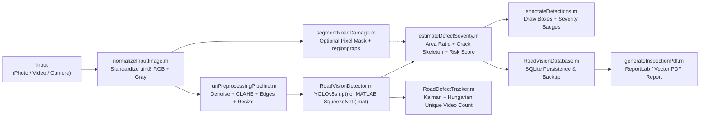

# RoadVision Developer & Student Architecture Guide

Welcome to **RoadVision**! This guide explains every module in plain, beginner-friendly language so you can understand how the system works under the hood, present it confidently to professors, and extend it easily.

---

## 1. System Data Flow (From Camera/Image to PDF Report)



---

## 2. What Every Major Module Does

### A. Core & Configuration (`src/matlab/core/`)
- **[loadConfig.m](../src/matlab/core/loadConfig.m):** Reads [roadvision_config.json](../config/roadvision_config.json) and resolves all folder paths dynamically relative to the project directory. This avoids hardcoded `C:\Users\...` paths so the code runs on any computer.
- **[ClassRegistry.m](../src/matlab/core/ClassRegistry.m):** Reads [classes.json](../config/classes.json). Instead of hardcoding `D00`, `D10`, `D20`, `D40` inside `if/else` chains everywhere, every module queries `ClassRegistry` for display names, RGB colors, and severity risk weights.
- **[RoadVisionLogger.m](../src/matlab/core/RoadVisionLogger.m):** Writes timestamped `[INFO]`, `[WARN]`, and `[ERROR]` messages into `logs/roadvision.log` for clean debugging.

### B. Digital Image Processing & Preprocessing (`src/matlab/preprocessing/`)
Why do we implement pure-MATLAB vectorized filters instead of blindly calling defaults?
1. **[normalizeInputImage.m](../src/matlab/preprocessing/normalizeInputImage.m):** Converts grayscale (`1` channel), RGBA (`4` channels), indexed colormaps, `uint16`, and float images (sanitizing `NaN`/`Inf`) safely into standard `uint8` RGB + grayscale.
2. **[applyDenoising.m](../src/matlab/preprocessing/applyDenoising.m):**
   - **Gaussian filter:** Separable 1D blur (`conv2`). Smooths sensor noise, *but* heavy Gaussian sigma (`2.5+`) smears out thin 1–2 px pavement cracks (`edgePreservationRatio` drops to `~0.15x`!).
   - **Median filter:** Sliding neighborhood `median` — removes salt-and-pepper gravel speckles while keeping step edges sharp.
   - **Bilateral filter:** Multiplies a spatial Gaussian kernel by an intensity-difference Gaussian kernel. Pixels across a dark crack edge have large intensity differences, so their weight drops near zero — smoothing flat asphalt without blurring cracks!
3. **[applyContrastEnhancement.m](../src/matlab/preprocessing/applyContrastEnhancement.m):**
   - **Histogram Equalization (`histeq`):** Stretches global luminance CDF across `[0..255]`.
   - **CLAHE (`clahe`):** Divides the image into an `8×8` tile grid, clips histogram peaks (`ClipLimit`) so uniform sky/asphalt noise doesn't explode, and bilinearly interpolates per-tile CDFs. Reveals faint hairline cracks in shadows!
   - **Gamma Correction (`gamma`):** Power-law transform $I_{\text{out}} = I_{\text{in}}^\gamma$ (`gamma < 1` brightens dark dusk/underpass images).
4. **[extractEdgesAndMorphology.m](../src/matlab/preprocessing/extractEdgesAndMorphology.m):** Runs Sobel gradients (`imgradientxy`) and full Canny (Gaussian smooth + Sobel + 4-direction Non-Maximum Suppression + double-threshold hysteresis) followed by morphological closing to bridge small breaks along a crack.
5. **[comparePreprocessingStages.m](../src/matlab/preprocessing/comparePreprocessingStages.m):** Produces the 5-panel comparison (`Original -> Noise-Reduced -> Contrast-Enhanced -> Edge-Detected -> Final Processed`) with real sharpness (`Tenengrad`), contrast gain, and SSIM telemetry.

### C. Detection Engine (`src/matlab/detection/` & `scripts/`)
- **[RoadVisionDetector.m](../src/matlab/detection/RoadVisionDetector.m):** Abstraction supporting:
  1. **Primary YOLOv8s (`yolov8_python`):** Runs Ultralytics YOLOv8 via [infer_yolov8.py](../scripts/infer_yolov8.py) (uses RTX 4050 CUDA GPU if available, else CPU).
  2. **Pure-MATLAB Baseline (`matlab_squeezenet` / alias `matlab_yolov4`):** Loads our SqueezeNet-backbone `dlnetwork` trained natively inside MATLAB R2024a ([trainNativeMatlabDetector.m](../src/matlab/detection/trainNativeMatlabDetector.m)) and applies pure-MATLAB greedy IoU Non-Maximum Suppression (`applyGreedyNms`).
- **[annotateDetections.m](../src/matlab/detection/annotateDetections.m):** Draws color-coded bounding boxes and crisp 5×7 bitmap labels directly onto a copy of the image without touching the original file.

### D. Damage Analysis & Severity Estimation (`src/matlab/severity/`)
- **[estimateDefectSeverity.m](../src/matlab/severity/estimateDefectSeverity.m):**
  Computes measurable geometric features for each box:
  - **Bounding-Box Area & Relative Area Ratio:** $\text{AreaRatio} = \frac{w \cdot h}{W_{\text{img}} \cdot H_{\text{img}}}$.
  - **Crack Length & Width:** If pixel segmentation is active, extracts the 1-pixel morphological skeleton (`rvBinaryOps.skeletonize`) inside the bounding box for length, and doubles the median distance-to-boundary (`2 * median(distMap(skel))`) for median width in pixels. Without segmentation, reports bounding-box diagonal span clearly labeled as a proxy.
  - **Calibrated Composite Severity Score:**
    $$\text{Score} = w_{\text{area}} \min\left(1, \frac{\text{AreaRatio}}{r_{\text{sat}}}\right) + w_{\text{risk}} R_{\text{class}} + w_{\text{conf}} C$$
    Mapped to **Low** ($\le 0.35$), **Medium** ($0.35 - 0.68$), **High** ($> 0.68$).
  - **Engineering Honesty:** Explicitly flags that **2D RGB images cannot measure pothole depth**, and physical centimeters/millimeters are reported **only** when `px_per_cm_calibrated` is provided from a physical scale reference.

### E. Modular Pixel Segmentation (`src/matlab/segmentation/`)
- **[segmentRoadDamage.m](../src/matlab/segmentation/segmentRoadDamage.m)** & **[rvBinaryOps.m](../src/matlab/segmentation/rvBinaryOps.m):** Completely separate from bounding-box detection! Supports classical morphological rules (`otsu_morph`, `canny_morph`, `hybrid_morphology`) plus a pure-MATLAB 3-level **Light-UNet (`dl_unet`)** trained via [trainMatlabCrackSegmenter.m](../src/matlab/segmentation/trainMatlabCrackSegmenter.m) (`auto` picks `dl_unet` when weights exist, otherwise `otsu_morph`), returning connected region metrics (`Area`, `Perimeter`, `Solidity`, `Eccentricity`, `MajorAxisLength`, `MinorAxisLength`, `damageCoverageRatio`).

### F. Video Tracking & Camera Capture (`src/matlab/video/`)
- **[RoadDefectTracker.m](../src/matlab/video/RoadDefectTracker.m):** Uses MATLAB's `vision.KalmanFilter` (4-state constant-velocity `[cx, cy, vx, vy]`) and `assignDetectionsToTracks` (Hungarian / Munkres assignment) with IoU + center-distance gating.
  - **Why tracking matters:** A 30 FPS dashcam sees the same pothole in ~25 consecutive frames. Without tracking, you would report "25 potholes" instead of **1 unique physical pothole**! `RoadDefectTracker` requires `MinHitsToConfirm = 2` consecutive hits and bridges brief occlusions up to `MaxMissedFrames = 8`.
- **[processRoadVideo.m](../src/matlab/video/processRoadVideo.m):** Reads frames with `VideoReader`, runs detection + tracking, writes annotated AVI with `VideoWriter`, and reports both `frameLevelDetections` and `uniqueDefectCount`, plus measured FPS.
- **[captureCameraFrame.m](../src/matlab/video/captureCameraFrame.m):** Uses OpenCV (`CAP_DSHOW` via [capture_webcam_frame.py](../scripts/capture_webcam_frame.py)) to capture live laptop/USB camera frames cleanly even when MATLAB's `imaqmex.mexw64` is restricted by Windows Smart App Control.

### G. GPS Mapping, SQLite & PDF Reporting
- **[extractGpsFromImage.m](../src/matlab/gps/extractGpsFromImage.m)** & **[renderGpsDamageMap.m](../src/matlab/gps/renderGpsDamageMap.m):** Reads authentic EXIF GPS tags (converting DMS to decimal degrees) or validated manual entry; plots severity-colored pins via `geoscatter`.
- **[RoadVisionDatabase.m](../src/matlab/database/RoadVisionDatabase.m):** Stores inspections and per-defect rows in SQLite (`inspections` and `detections` tables), supports integrity checking (`PRAGMA integrity_check`) and timestamped `.db` backups.
- **[generateInspectionPdf.m](../src/matlab/reporting/generateInspectionPdf.m)** & **[generate_pdf_report.py](../scripts/generate_pdf_report.py):** Generates structured PDF inspection reports with side-by-side original/annotated images, tables, explanations, recommendations, and limitations.

---

## 3. How to Add a New Damage Category (e.g., `D50` Patch / Manhole)

Thanks to `ClassRegistry` and centralized configs, adding a new category requires **zero changes to UI, database, severity, or converter logic**:
1. Open [config/classes.json](../config/classes.json) and append a new entry:
   ```json
   {
     "id": 4,
     "code": "D50",
     "display_name": "Utility Patch / Manhole",
     "group": "patch",
     "risk_weight": 0.40,
     "color_rgb": [160, 90, 240],
     "description": "Road utility cover or asphalt patch repair."
   }
   ```
2. Re-run annotation conversion so `roadvision_rdd.yaml` updates `nc: 5`:
   ```powershell
   .\.venv\Scripts\python.exe scripts\convert_annotations.py
   ```
3. Retrain or fine-tune the model:
   ```powershell
   .\.venv\Scripts\python.exe scripts\train_yolov8.py --data-yaml data/processed/yolo_dataset/roadvision_rdd.yaml --epochs 35
   ```

---

## 4. Common Troubleshooting

| Symptom | Root Cause | Solution |
| :--- | :--- | :--- |
| `An Application Control policy has blocked this file` inside MATLAB | Windows 11 Smart App Control blocks specific older MathWorks MEX/DLL binaries (`images_builtins`, `vision_builtins`, `pyenv`, `mlreportgen_dom`, `imaqmex`). | RoadVision automatically uses pure-MATLAB vectorized implementations (`rvBinaryOps`, `applyDenoising`, `applyContrastEnhancement`, `annotateDetections`), `system()` Python bridge, OpenCV webcam capture, and ReportLab/vector PDFs. Never replace those with the blocked builtins. |
| `RoadVision:ModelNotTrained` | No `.pt` or `.mat` checkpoint present in `models/`. | Run `scripts/train_yolov8.py` or `trainNativeMatlabDetector(...)` first. |
| `CUDA unavailable` in Python | Using global system Python instead of `.venv`, or CPU-only PyTorch wheel installed. | Run using `.venv\Scripts\python.exe` with `torch+cu126`. |
| `SQLite Unexpected NULL` | Querying nullable `REAL` column directly in MATLAB `sqlite()`. | `RoadVisionDatabase` uses `COALESCE` sentinels (`-1.0` / `-999.0`) mapped back to `NaN`. |
