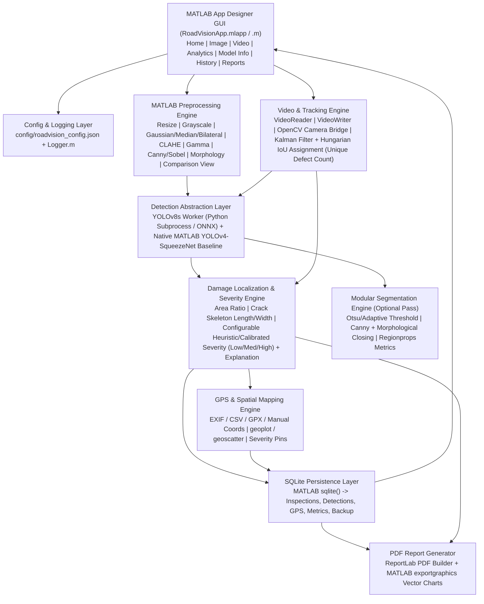

# RoadVision — Phase 1 Feasibility Assessment, System Architecture & Roadmap

**Project Name:** RoadVision – Intelligent Road Damage Detection, Classification & Severity Assessment System  
**Phase:** 1 — Environment Inspection & Feasibility Analysis  
**Inspection Date:** 2026-11-25  
**Target Repository:** `AyushSharma-ece/roadvision-road-damage-detection`

---

## 1. Inspected Hardware & Software Environment

All findings below were directly measured on the target development workstation (never assumed).

### 1.1 Hardware Specification

| Component | Measured Specification | Engineering Implication |
| :--- | :--- | :--- |
| **OS** | Microsoft Windows 11 Home Single Language (Build `26200`) | Windows Smart App Control (`VerifiedAndReputablePolicyState = 1`) is enforced and blocks several unsigned/unreputed MATLAB MEX/DLL extensions. |
| **CPU** | 16 logical cores | Sufficient for parallel image preprocessing, dataset validation, and video frame I/O (`DispatchInBackground`). |
| **System RAM** | `15.78 GiB` | Requires streaming / datastore (`imageDatastore`, `boxLabelDatastore`) and chunked dataset processing rather than loading full datasets into memory. |
| **GPU** | **NVIDIA GeForce RTX 4050 Laptop GPU** (`6141 MiB` / ~6 GB VRAM, Compute Capability `8.9`, Driver `581.86`, CUDA `13.0`) | Supports fast FP16/FP32 training and real-time inference for lightweight/small YOLO models (`640×640`, batch size `8–16`), provided VRAM is managed carefully. |
| **Disk Space (`C:\`)** | `~199.17 GiB` free (`213,858,349,056` bytes) of `474.72 GiB` | Sufficient for multi-country RDD2022 + Crack500/CFD/DeepCrack/Pothole-600 archives (`~14 GB` raw + processed splits). |
| **Camera** | Integrated Camera (`Status: OK`) | Accessible outside restricted app sandboxes via OpenCV `CAP_DSHOW` at `(480, 640, 3)`. |

### 1.2 MATLAB Environment Audit

- **Primary & Active MATLAB Installation: `C:\Program Files\MATLAB\R2024a` (`v24.1.0.2537033`)** — Registered in Windows (`HKLM\SOFTWARE\MathWorks\MATLAB\24.1`), licensed, and complete with 110+ toolboxes plus verified GPU acceleration (`gpuDevice(1)` -> NVIDIA GeForce RTX 4050 Laptop GPU, `gpuArray` tested).
- **Note on `C:\Program Files\MATLAB\R2026a` Folder:** An unregistered, partial folder remnant exists on disk (missing `nnet`, `parallel`, `database`, `mlreportgen`, `stats`; exits with `0xc0000135`). It is **not** a usable installation and is completely excluded from RoadVision.

#### Verified MATLAB R2024a Capabilities & Restrictions

| Capability / API | Measured Status | Notes & Architectural Workaround |
| :--- | :--- | :--- |
| Image Processing Toolbox (`images`) | **Working** | Full access to `adapthisteq` (CLAHE), `imgaussfilt`, `medfilt2`, `imbilatfilt`, `edge`, `bwmorph`, `regionprops`. |
| Computer Vision Toolbox (`vision`) | **Working** | `yolov4ObjectDetector`, `trainYOLOv4ObjectDetector`, `estimateAnchorBoxes`, `evaluateObjectDetection`, `vision.KalmanFilter`, `vision.PointTracker`, `assignDetectionsToTracks`. |
| Deep Learning Toolbox (`nnet`) + GPU | **Working** | `trainnet`, `dlnetwork`, `imagePretrainedNetwork('squeezenet')` (68 layers, built-in pretrained weights). |
| Database Toolbox (`sqlite`) | **Working** | Native SQLite database creation, query, and parameterized operations verified. |
| Video I/O (`VideoReader`, `VideoWriter`) | **Working** | Verified frame writing (`Motion JPEG AVI`) and reading. |
| Mapping (`geoplot`, `geoscatter`) | **Working** | Built-in geographic plotting verified. |
| App Designer / `uifigure` | **Working** | Verified UI figure and component creation. |
| Sensor Fusion (`trackerGNN`) | **Working** | Available for multi-object tracking extensions. |
| `exportgraphics(..., 'ContentType', 'vector', 'Append', true)` | **Working** | Multi-page vector PDF export verified natively in MATLAB. |
| Support Packages (`YOLOV4`, `ONNXCONVERTER`, `RESNET50`, `MOBILENETV2`, `DARKNET53`, `DL_TENSORFLOW_LITE`, `WEBCAM`) | **Not Installed** | Calling `yolov4ObjectDetector('tiny-yolov4-coco')`, `importNetworkFromONNX`, `loadTFLiteModel`, or `imagePretrainedNetwork('resnet50')` requires Add-On installation. Custom-backbone `yolov4ObjectDetector(imagePretrainedNetwork('squeezenet'), ...)` works **without** any Add-On! |
| `pyenv` (`mwpyversion_builtinimpl.dll`) | **Blocked by Smart App Control** | Workaround: Invoke Python externally via `system(...)` or lightweight local worker rather than in-process `pyenv`. |
| `imaqhwinfo` (`imaqmex.mexw64`) | **Blocked by Smart App Control** | Workaround: Acquire webcam frames via Python OpenCV `cv2.VideoCapture(0, cv2.CAP_DSHOW)` bridge. |
| `mlreportgen.report.Report` (`mwmlreportgen_dom_builtinimpl.dll`) | **Blocked by Smart App Control** | Workaround: Primary rich PDF generation via Python `reportlab` (`v5.1.0`, verified) + native MATLAB `exportgraphics` vector PDF fallback. |

### 1.3 Python, Git & GitHub Audit

| Tool | Measured Status | Notes |
| :--- | :--- | :--- |
| **Python 3.11.9** | Installed (`C:\Users\Ayush\AppData\Local\Programs\Python\Python311\python.exe`) | Compatible with MATLAB R2024a ecosystem; has `ultralytics 8.4.216`, `opencv-python 5.0.0`, `reportlab 5.1.0`, `sqlite 3.45.1`, currently `torch 2.15.0+cpu` (no CUDA yet). |
| **Python 3.14.6** | Installed (`C:\Program Files\Python314\python.exe`) | Has `torch 2.13.0+cpu`, `ultralytics 8.4.216`, `streamlit 1.62.0`. Less standard for CUDA wheels; use dedicated Python 3.11 `.venv` for RoadVision. |
| **PyTorch CUDA index (`cu126`)** | Reachable (`HTTP 200 OK` via `curl.exe`) | Allows creating an isolated project `.venv` with CUDA PyTorch if GPU-accelerated YOLOv8 training is compatible with Smart App Control. |
| **Git / GitHub CLI** | `git 2.56.1`, `gh 2.105.0` | Authenticated as `AyushSharma-ece` (`repo`, `read:org`, `gist` scopes). Target repository `roadvision-road-damage-detection` does not exist yet. |

---

## 2. Feasibility Analysis & Detection Architecture Selection

### 2.1 Candidate Model Comparison

| Criterion | Pure MATLAB `yolov4ObjectDetector` (SqueezeNet) | Pure MATLAB `fasterRCNNObjectDetector` / `ssdObjectDetector` | **YOLOv8s (`ultralytics` PyTorch/ONNX)** | **YOLOv11s (`ultralytics`)** |
| :--- | :--- | :--- | :--- | :--- |
| **Detection Accuracy (Thin Cracks D00/D10/D20 + D40)** | Moderate (~30–42% mAP@0.5 typical; SqueezeNet lacks modern CSP/C2f neck & anchor-free DFL head) | Faster R-CNN accurate on blobs, weak speed; SSD poor on thin elongated cracks | **High** (C2f + SPPF + PAN-FPN + anchor-free decoupled head + CIoU/DFL loss; strong RDD2022 benchmarks) | **High** (C3k2 + C2PSA; ~comparable accuracy, newer & heavier attention) |
| **Training Requirements (6 GB VRAM)** | Low (~2–3 GB VRAM in MATLAB GPU) | High VRAM (Faster R-CNN) / Low (SSD) | **Fits cleanly** (`640×640`, batch 16, AMP FP16 uses ~3.5 GB VRAM) | Fits cleanly (~3.8 GB VRAM) |
| **Inference Speed (RTX 4050)** | Fast (~15–30 ms/frame in MATLAB) | Faster R-CNN slow (~80–150 ms); SSD fast | **Very Fast** (~5–12 ms/frame GPU; ~35–60 ms CPU) | Fast (~6–14 ms/frame GPU) |
| **MATLAB R2024a Compatibility** | **100% Native** (`squeezenet` works without Add-Ons) | Native (`squeezenet` only without Add-Ons) | **Hybrid Bridge** (`importNetworkFromONNX` & `pyenv` unavailable/blocked -> invoke via local Python/ONNX subprocess worker from MATLAB) | Hybrid Bridge |
| **Model Size** | ~15–25 MB (`.mat`) | ~50–180 MB | **~22 MB** (`.pt` / `.onnx`) | ~19 MB |
| **Ease of Deployment** | Highest (zero external runtime) | High | High with project `.venv` + CPU/ONNX fallback | Moderate |

### 2.2 Selected Engineering Strategy: Dual-Engine Architecture

To maximize **both** engineering accuracy on real Indian road damage and **100% reliability** inside MATLAB R2024a:

1. **Primary High-Accuracy Detector (YOLOv8s via Ultralytics / ONNX-capable Python Worker):**
   - Trained in a dedicated Python 3.11 virtual environment (`.venv`) with reproducible seeds, checkpoints, and GPU acceleration (pending Phase 3 verification that CUDA PyTorch DLLs load cleanly under Windows Smart App Control).
   - Called seamlessly by MATLAB through a clean **Detector Interface (`RoadDetector.m`)** using a persistent or batch local JSON/file IPC worker (never `pyenv`, which is blocked by Smart App Control).
   - Supports CPU fallback automatically on machines without an NVIDIA GPU.
2. **Native Pure-MATLAB Baseline Detector (`yolov4ObjectDetector` + SqueezeNet):**
   - Built and trained natively inside MATLAB R2024a on the RTX 4050 GPU (`trainYOLOv4ObjectDetector`) using `imagePretrainedNetwork('squeezenet')` — zero external dependencies or Add-Ons required.
   - Enables direct **academic benchmarking** (`YOLOv4-SqueezeNet` vs `YOLOv8s` on identical RDD2022 test splits!) and serves as a **100% self-contained MATLAB fallback** inside the App Designer UI.

---

## 3. Dataset Research & Verification Summary

| Dataset | Official Source | Verified Access | License / Restrictions | Native Format | Classes & Role in RoadVision |
| :--- | :--- | :--- | :--- | :--- | :--- |
| **RDD2022** | [sekilab/RoadDamageDetector](https://github.com/sekilab/RoadDamageDetector) & [Figshare 21431547](https://doi.org/10.6084/m9.figshare.21431547) | Old S3 country links returned **403 Forbidden**; Figshare primary archive (`12.35 GB`) resolves via Figshare API (`GET` presigned R2 URL; `HEAD` forbidden). Kaggle mirror also available. | **CC BY-SA 4.0** (attribution required; ShareAlike on derivatives; do not redistribute raw archive in GitHub). | Pascal VOC XML (`train`), unlabelled images (`test`) | **Primary 4-class object detection dataset** (`D00`, `D10`, `D20`, `D40`). Prioritize **India** subset + multi-country subsets (Japan, Czech, US, China, Norway) for diversity. |
| **RDD2020 / RDD2019** | Mendeley `10.17632/5ty2wb6gvg.1` / `sekilab` | Reference archive | **CC BY-SA 4.0** | Pascal VOC XML | **Subsumed in RDD2022** (India/Japan/Czech overlap). Only inspect for reference/audit; **do not blindly merge** to avoid train/test leakage. |
| **Crack500** | [fyangneil/pavement-crack-detection](https://github.com/fyangneil/pavement-crack-detection) | Google Drive / OneDrive / Kaggle mirror | **Non-commercial academic research** (citation required). | Pixel-level binary masks (`2560×1440` + patches) | **Phase 9 crack segmentation evaluation & width/length calibration** (not mixed into 4-class box detection). |
| **CFD (Crack Forest)** | [cuilimeng/CrackForest-dataset](https://github.com/cuilimeng/CrackForest-dataset) | GitHub ZIP verified `HTTP 200 OK` | **Non-commercial research purposes only**. | Pixel masks (`480×320`, 118 images) | **Phase 9 segmentation benchmark** & morphological crack extraction verification. |
| **DeepCrack** | [yhlleo/DeepCrack](https://github.com/yhlleo/DeepCrack) | GitHub ZIP verified `HTTP 200 OK` | **Non-commercial research & educational use**. | Pixel masks (537 RGB images) | **Phase 9 crack segmentation benchmark**. |
| **Pothole-600** | [hlwang1124/AAFramework](https://github.com/hlwang1124/AAFramework) / [pothole600-segmentation](https://github.com/large-road-damage-datalake/pothole600-segmentation) | Project page / Kaggle mirror | Research use (no explicit SPDX on origin; Kaggle cites MIT). | Pixel masks (600 images) | **Phase 9 pothole segmentation evaluation** (separate from RDD2022 box splits). |
| **Custom Indian Road Set** | Local capture protocol | User / project local (`data/raw/custom_india/`) | Project-owned | Raw JPEG/PNG (+ EXIF GPS if present) | Unseen rural/urban/highway/wet/low-light generalization testing. |

---

## 4. Complete Modular System Architecture



### Directory Layout (Planned for Phase 3)

```text
ROADVISION/
├── config/                  # Tunable JSON configs (paths, thresholds, severity rules, class map)
├── data/                    # Git-ignored raw/interim/processed datasets + source register CSV/MD
├── docs/                    # Architecture, Dataset Register, Progress Tracker, Academic Report, Dev Guide
├── models/                  # Saved checkpoints, model metadata JSON, trained .mat / .pt / .onnx weights
├── reports/                 # Generated inspection PDFs & evaluation charts (git-ignored outputs)
├── scripts/                 # Python helpers (dataset acquisition, annotation conversion, YOLOv8 train/infer, PDF)
├── src/
│   ├── matlab/
│   │   ├── app/             # MATLAB App Designer UI & controllers
│   │   ├── core/            # Config loader, logger, class registry
│   │   ├── preprocessing/   # Modular DIP pipeline & 5-stage comparison tool
│   │   ├── detection/       # MATLAB YOLOv4 trainer/detector + YOLOv8 worker adapter
│   │   ├── severity/        # Area, skeleton length/width, calibrated severity scoring & explanations
│   │   ├── segmentation/    # Separate crack/pothole pixel-level segmentation module
│   │   ├── video/           # VideoReader/Writer, Kalman+Hungarian unique-defect tracker, webcam bridge
│   │   ├── gps/             # EXIF/CSV/manual GPS parser & geoplot/geoscatter visualizer
│   │   ├── database/        # SQLite schema, CRUD, validation, backup
│   │   └── reporting/       # Report orchestration & vector chart export
│   └── python/              # Dedicated worker modules (YOLOv8 runner, ReportLab PDF, webcam capture)
├── tests/                   # MATLAB matlab.unittest suites + Python pytest integration/edge-case tests
├── CHANGELOG.md
├── CONTRIBUTING.md
├── LICENSE
├── README.md
└── requirements.txt
```

---

## 5. Technical Risks & Mitigation Plan

| Risk ID | Risk Description | Likelihood / Impact | Mitigation Strategy |
| :--- | :--- | :--- | :--- |
| **R1** | Windows Smart App Control blocks DLLs (`pyenv`, `imaqmex`, `mlreportgen_dom`, or potentially `torch_cuda.dll`). | **Observed / High** | Already bypassed MATLAB DLL blocks via `system()`, OpenCV `CAP_DSHOW`, `reportlab`, and `exportgraphics`. Test `torch_cuda.dll` early in Phase 3; pure-MATLAB RTX 4050 YOLOv4 guarantees zero-block fallback. |
| **R2** | Old RDD2022 S3 country zip URLs return `403 Forbidden`, requiring full 12.35 GB Figshare download or Kaggle mirror. | **Observed / Medium** | Use `curl.exe -C - -L` against Figshare R2 presigned `GET` URL (`38030910`) or verified mirror, extracting India + balanced multi-country subsets cleanly with checksum/integrity verification. |
| **R3** | Data leakage between RDD2020 and RDD2022 or consecutive video frames in training/test splits. | **High / High** | Never merge RDD2020 blindly into RDD2022; run perceptual/MD5 duplicate hashing and sequence/country-aware group splitting so unseen test images never leak into training. |
| **R4** | Class imbalance (`D00` vs `D40` / `D10` / `D20`) and thin crack recall loss from aggressive smoothing or small input sizes. | **Medium / High** | Benchmark preprocessing carefully (never blindly blur cracks); use class-stratified sampling/weights, anchor estimation, and `640×640` input resolution. |
| **R5** | False physical measurement claims (2D image cannot measure pothole depth; uncalibrated pixels ≠ millimeters). | **Critical** | Report relative area (`%`), normalized pixel geometry, and explicit scale/calibration flags; require known reference / calibration metadata before showing physical units, and never claim depth from 2D images. |
| **R6** | 6 GB VRAM OOM during training or large-video processing. | **Medium / Medium** | Cap batch size (`8–16` for YOLOv8s, `4–8` for MATLAB YOLOv4), use FP16 AMP, and process videos frame-by-frame in streaming mode without storing full frame tensors in RAM. |

---

## 6. 18-Phase Development Roadmap

| Phase | Milestone | Key Deliverable |
| :--- | :--- | :--- |
| **1** | Environment Inspection & Feasibility | Verified environment scripts, Architecture & Feasibility Report, Progress Tracker *(Current)* |
| **2** | Dataset Research, Collection & Validation | `docs/DATASET_REGISTER.md`, verified downloads, duplicate/integrity audit, leakage-free train/val/test splits |
| **3** | Project Structure & Configuration | Standardized folder hierarchy, JSON config schema, logger, extensible class registry (`D00`, `D10`, `D20`, `D40`, ...) |
| **4** | MATLAB Preprocessing Engine | Modular DIP filters/enhancers + 5-stage visual comparison engine + ablation evaluation |
| **5** | Annotation Conversion & Validation | Pascal VOC XML ↔ YOLO TXT ↔ COCO JSON ↔ MATLAB `table` verified converters & validators |
| **6** | Detection Model Training | Reproducible training scripts, checkpoints, pure-MATLAB YOLOv4-SqueezeNet baseline + YOLOv8s model |
| **7** | Image Detection & Classification | Unified detector API returning class, confidence, bbox, ID, normalized/pixel location, configurable NMS/threshold |
| **8** | Severity Estimation Engine | Documented, calibrated Low/Medium/High severity rules + human-readable justification + calibration notes |
| **9** | Segmentation Module | Separate crack/pothole pixel segmentation engine + evaluation against Crack500/CFD/DeepCrack/Pothole-600 |
| **10** | Video Processing & Tracking | Frame-by-frame detection, Kalman/Hungarian IoU multi-object tracking, unique defect counter, FPS benchmark, webcam mode |
| **11** | GPS Mapping Module | EXIF/CSV/manual GPS ingestion + `geoplot`/`geoscatter` severity map & route summary |
| **12** | MATLAB App Designer Interface | 7-section desktop GUI (`Home`, `Image`, `Video`, `Analytics`, `Model Info`, `History`, `Reports`) fully wired to backend |
| **13** | Database & PDF Reporting | SQLite CRUD/backup + ReportLab & MATLAB vector PDF report generator (never mutating source media) |
| **14** | Integration & Performance Optimization | GPU/CPU benchmarking, resizing/batch tuning, memory profiling, verified hardware timings |
| **15** | Automated Testing & Debugging | MATLAB `matlab.unittest` + Python `pytest` suites covering all 12 test scenarios + 12 edge cases |
| **16** | Complete Documentation | 21-section Academic Project Report + Beginner-Friendly Developer Guide & Flowcharts |
| **17** | GitHub Preparation & Publication | Clean `.gitignore`, `LICENSE`, `CONTRIBUTING.md`, `CHANGELOG.md`, milestone commits, verified push to GitHub |
| **18** | Final Verification & Release | End-to-end clean-run acceptance audit & tagged versioned release (`v1.0.0`) |
