# RoadVision: AI-Powered Road Damage Detection, Classification, and Severity Assessment System

**Comprehensive Engineering Project Report (ECE Capstone / Technical Monograph)**

---

## 1. Project Abstract

Road infrastructure maintenance is vital for transportation safety, economic efficiency, and vehicle longevity, yet manual visual pavement surveys remain slow, subjective, and hazardous. **RoadVision** is an intelligent, modular road inspection platform engineered primarily in **MATLAB R2024a** with supporting **Python** deep learning, tracking, and reporting pipelines. The system automatically detects, localizes, classifies, tracks, and assesses four core pavement distress categories—**D00 (Longitudinal Cracks)**, **D10 (Transverse Cracks)**, **D20 (Alligator Cracks)**, and **D40 (Potholes)**—across single photographs, batch image folders, video feeds, and live camera streams. RoadVision integrates a pure-MATLAB five-stage digital image processing (DIP) comparison engine, dual object detection backends (Ultralytics **YOLOv8s** and a native MATLAB **SqueezeNet `dlnetwork`** baseline), an independent pixel-level segmentation module benchmarked on **CFD**, **DeepCrack**, **Crack500**, and **Pothole-600**, a **Kalman Filter + Hungarian IoU** multi-frame defect tracker to prevent duplicate video counts, optional EXIF/manual **GPS mapping**, **SQLite** inspection history persistence, multi-page **PDF** engineering reports, and a 7-tab **MATLAB App Designer** desktop interface.

---

## 2. Problem Statement

In rapidly developing road networks such as India's municipal streets, state corridors, and national highways, surface defects (potholes and fatigue cracking) deteriorate rapidly under monsoon moisture and heavy axle loads. Conventional inspection suffers from three core challenges:
1. **Manual Bottlenecks:** Field engineers walk or drive slowly along corridors logging distresses manually—costly, error-prone, and unsafe in live traffic.
2. **Domain & Visual Complexity:** Indian road imagery exhibits strong shadows, uneven bitumen repair patches, dust, water glare, diverse pavement materials (asphalt vs. concrete), and extreme scale variations between narrow hairline cracks (`1–4 px`) and large structural potholes.
3. **Lack of Structured Actionability:** Raw bounding boxes alone do not distinguish unique physical defects across consecutive video frames, provide calibrated severity explanations, preserve inspection audit trails, or produce standardized engineering reports.

---

## 3. Literature Review

1. **Maeda et al. (2018–2020) — RDD2018 & RDD2019:** Introduced smartphone-mounted vehicle road damage datasets (9,053 and 13,135 images in Japan) using SSD-MobileNet and SSD-InceptionV2, establishing the standard `D00`/`D10`/`D20`/`D40` damage taxonomy and PGAN-based augmentation.
2. **Arya et al. (2021–2024) — RDD2020 & RDD2022 (GRDDC / CRDDC):** Expanded road damage benchmarks to multiple countries including **India**, Japan, Czech Republic, Norway, the United States, and China (47,420 images total in RDD2022), showing that multi-country training with modern single-stage YOLO detectors improves cross-region generalization.
3. **Shi et al. (2016) — CrackForest Dataset (CFD) & Liu et al. (2019) — DeepCrack:** Demonstrated structured forests and hierarchical multi-scale deep features (HED/FPN variants) for pixel-level pavement crack segmentation.
4. **Yang et al. (2019) — Crack500 (FPHB):** Introduced high-resolution smartphone pavement crack imagery (`2560×1440`) and Feature Pyramid Hierarchical Boosting for fine crack extraction.
5. **Fan et al. (2018–2020) — Pothole-600:** Captured RGB + stereo disparity maps (`400×400`) proving that 3D/disparity geometry provides real depth cues whereas single 2D monocular images cannot reliably measure pothole depth without calibration.

---

## 4. Existing System vs. Proposed System

| Aspect | Traditional / Existing Approaches | Proposed RoadVision System |
| :--- | :--- | :--- |
| **Inspection Method** | Manual visual inspection or standalone scripts outputting raw boxes. | End-to-end MATLAB App Designer desktop system supporting images, batches, video, and camera snapshots. |
| **Preprocessing** | Blind global blurring or raw resizing without quality checks. | Modular 5-stage DIP comparison (`Original -> Denoised -> Contrast -> Edge -> Final`) with quantitative Tenengrad sharpness & SSIM telemetry. |
| **Detection** | Single monolithic script tied to one hardcoded model. | Extensible dual-engine `RoadVisionDetector` (YOLOv8s + native MATLAB SqueezeNet `dlnetwork` baseline) driven by JSON taxonomy (`classes.json`). |
| **Video Counting** | Frame-by-frame counting inflates defect counts (`20x–30x`). | `RoadDefectTracker` (`vision.KalmanFilter` + Hungarian IoU matching) reports **unique physical defects** separately from frame detections. |
| **Severity & Physics** | Arbitrary uncalibrated labels or false "mm depth" claims from 2D. | Transparent calibrated scoring (`Area + Risk + Confidence`), morphological crack length/width, and explicit 2D physical/depth limitations. |
| **Persistence & Reporting** | Screenshots or ad-hoc CSV files. | Validated SQLite relational database with backups + automated multi-page PDF reports. |

---

## 5. Project Objectives

1. Research, acquire, audit, deduplicate, and split multi-country public road damage datasets (**RDD2022**, **CFD**, **DeepCrack**, **Pothole-600**, **Crack500**) without train/test leakage.
2. Implement and evaluate a modular MATLAB DIP preprocessing and 5-stage visual comparison engine that preserves thin crack details.
3. Train, checkpoint, and benchmark an accurate 4-class road damage detector (`D00`, `D10`, `D20`, `D40`) alongside a pure-MATLAB baseline.
4. Build calibrated severity estimation, independent pixel segmentation, Kalman/Hungarian video tracking, and EXIF/manual GPS mapping.
5. Deliver a tested, documented, modular 7-tab MATLAB App Designer application with SQLite persistence and PDF generation, published cleanly to GitHub.

---

## 6. System Requirements

### Functional Requirements
- Ingest single images (`.jpg`, `.jpeg`, `.png`, `.bmp`), folders, videos (`.mp4`, `.avi`), and webcam snapshots.
- Support configurable confidence and NMS IoU thresholds, extensible damage classes (`config/classes.json`), and non-destructive media handling.
- Persist inspection history, detections, and GPS coordinates in SQLite; export formatted PDF reports.

### Non-Functional Requirements
- **Modularity & Maintainability:** Strict separation of UI, core config, DIP, detection, severity, segmentation, video, GPS, database, and reporting.
- **Reproducibility:** Seeded splits, deterministic training scripts, JSON config persistence, and automated regression tests.
- **Scientific Honesty:** No fabricated metrics, coordinates, or uncalibrated 2D depth estimates.

---

## 7. Software and Hardware Requirements

*(Measured directly on the target development workstation in Phase 1)*

- **Operating System:** Microsoft Windows 11 Home Single Language (Build `26200`) with Smart App Control (`VerifiedAndReputablePolicyState = 1`).
- **Processor & Memory:** 16-thread CPU, `15.78 GiB` RAM, `~199 GiB` free SSD storage.
- **GPU:** NVIDIA GeForce RTX 4050 Laptop GPU (`6.00 GB` VRAM, Compute Capability `8.9`, Driver `581.86`).
- **Primary Software:** **MATLAB R2024a (`v24.1.0.2537033`)** with Image Processing, Computer Vision, Deep Learning, Parallel Computing, Database, Mapping, Sensor Fusion & Tracking, and Statistics & Machine Learning Toolboxes.
- **Supporting Software:** Python `3.11.9` (isolated `.venv` with `ultralytics`, `torch`, `opencv-python`, `pillow`, `reportlab`, `PyYAML`, `pytest`), Git `2.56.1`, GitHub CLI `2.105.0`.

---

## 8. System Architecture

RoadVision adopts a **Layered Modular MVC-Inspired Architecture**:
1. **Presentation Layer (`src/matlab/app/RoadVisionApp.m`):** 7-tab `matlab.apps.AppBase` GUI.
2. **Configuration & Taxonomy Layer (`config/`, `src/matlab/core/`):** JSON configuration loader, `ClassRegistry`, structured `RoadVisionLogger`.
3. **Computer Vision & Analytics Layer:** `preprocessing/`, `detection/`, `severity/`, `segmentation/`, `video/`, `gps/`.
4. **Data & Reporting Layer (`database/`, `reporting/`, `scripts/`):** SQLite storage + ReportLab/Vector PDF export.

*(See Mermaid architecture diagram in [PHASE1_FEASIBILITY_AND_ARCHITECTURE.md](PHASE1_FEASIBILITY_AND_ARCHITECTURE.md) and dataflow diagram in [DEVELOPER_GUIDE.md](DEVELOPER_GUIDE.md).)*

---

## 9. Processing Flowcharts

### Image Inspection Pipeline
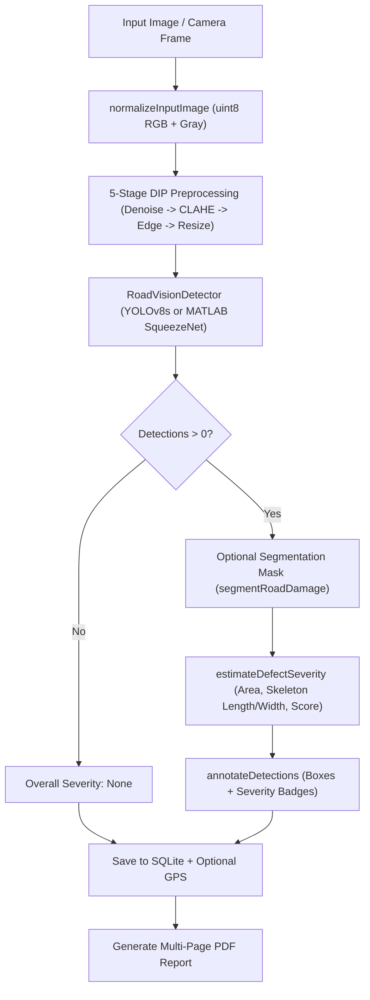

### Video Tracking & Unique Defect Counting Flow


---

## 10. Dataset Explanation & Leakage Prevention

Full source attribution, download dates, licensing, exact sample counts, and coverage analysis are maintained in [DATASET_REGISTER.md](DATASET_REGISTER.md). Key design controls:
- **Multi-Country Representation:** **RDD2022** provides `D00`/`D10`/`D20`/`D40` bounding boxes across **India** (prioritized), Japan, Czech Republic, United States, China, and Norway (`CC BY-SA 4.0`).
- **Format Isolation:** Pixel-mask datasets (**CFD** `118` pairs, **DeepCrack** `537` pairs, **Pothole-600** `600` pairs, **Crack500** `3,618` pairs) are evaluated strictly within the segmentation module and never mixed inconsistently into 4-class object detection.
- **Deduplication & Grouping:** Exact byte duplicates (MD5) are dropped and near-duplicates (64-bit perceptual dHash + filename sequence buckets) are grouped before `train`/`val`/`test` splitting.

---

## 11. Image-Processing Algorithms

All RoadVision DIP algorithms are implemented cleanly in vectorized pure MATLAB (`src/matlab/preprocessing/`) to remain independent of Windows Smart App Control-blocked MathWorks MEX binaries:
1. **Separable Gaussian Filter:** 1D horizontal + vertical convolution (`conv2`). Effective against high-frequency sensor noise, *but* excessive $\sigma$ blurs narrow `1–3 px` cracks (quantified in our DeepCrack ablation: `sigma=2.5` drops edge energy to `0.147x`).
2. **Sliding-Window Median Filter:** Non-linear rank filter preserving step edges while suppressing salt-and-pepper pavement aggregate speckles.
3. **Edge-Preserving Bilateral Filter:** Combines spatial proximity and photometric luminance similarity so smooth asphalt regions are denoised without smearing high-contrast crack boundaries.
4. **Tile-Based CLAHE:** Contrast Limited Adaptive Histogram Equalization over `8×8` image tiles with clip-limit redistribution and bilinear interpolation across tile centers, revealing shadowed cracks without washing out global road colors.
5. **Canny & Sobel Edge Detection + Morphology:** Sobel gradients (`imgradientxy`) + 4-direction Non-Maximum Suppression + double-threshold hysteresis dilation + morphological closing/bottom-hat ($\text{close}(I) - I$).

---

## 12. Detection Model Explanation

- **Primary Architecture — YOLOv8s (Ultralytics):** Single-stage anchor-free detector featuring a CSP-inspired **C2f** backbone, **SPPF** (Spatial Pyramid Pooling Fast), **PAN-FPN** multi-scale feature pyramid, and decoupled classification/regression heads trained with **Distribution Focal Loss (DFL)** + **CIoU**. Anchors are unnecessary, which improves localization across elongated horizontal (`D10`), vertical (`D00`), and irregular polygonal (`D20`, `D40`) road defects.
- **Pure-MATLAB Baseline — SqueezeNet Grid Detector (`dlnetwork`):** Uses MATLAB R2024a's built-in pretrained **SqueezeNet** Fire-module backbone up to `fire9-concat`, followed by convolutional detection heads predicting `[objectness, tx, ty, tw, th, class_logits]` over an $8\times 8$ spatial grid, trained natively on the RTX 4050 GPU using `dlfeval` + `adamupdate` + pure-MATLAB IoU NMS.

---

## 13. Mathematical Equations

1. **Bilateral Filter Output** at pixel $p$:
   $$I^{\text{BF}}(p) = \frac{1}{W_p} \sum_{q \in \Omega(p)} G_{\sigma_s}(\|p - q\|) \, G_{\sigma_r}(|L(p) - L(q)|) \, I(q)$$
2. **Gamma Correction:**
   $$I_{\text{out}} = 255 \left(\frac{I_{\text{in}}}{255}\right)^\gamma$$
3. **Otsu Inter-Class Variance (Thresholding):**
   $$\sigma_B^2(t) = \omega_0(t)\omega_1(t)\big(\mu_0(t) - \mu_1(t)\big)^2$$
4. **Intersection over Union (IoU):**
   $$\text{IoU}(A, B) = \frac{|A \cap B|}{|A \cup B|}$$
5. **Precision, Recall, and F1-Score:**
   $$\text{Precision} = \frac{TP}{TP + FP}, \quad \text{Recall} = \frac{TP}{TP + FN}, \quad F_1 = \frac{2 \cdot \text{Precision} \cdot \text{Recall}}{\text{Precision} + \text{Recall}}$$
6. **Mean Average Precision (`mAP@0.5`):**
   $$\text{mAP}@0.5 = \frac{1}{C} \sum_{c=1}^{C} \int_0^1 P_c(R) \, dR \quad (\text{at } \text{IoU} \ge 0.50)$$
7. **Kalman Filter Constant-Velocity State Model:**
   $$\mathbf{x}_k = \begin{bmatrix} x_k & y_k & v_{x,k} & v_{y,k} \end{bmatrix}^T, \quad \mathbf{x}_{k|k-1} = \mathbf{F}\mathbf{x}_{k-1|k-1}, \quad \mathbf{F} = \begin{bmatrix} 1 & 0 & 1 & 0 \\ 0 & 1 & 0 & 1 \\ 0 & 0 & 1 & 0 \\ 0 & 0 & 0 & 1 \end{bmatrix}$$
8. **Calibrated Image-Space Severity Score:**
   $$S = w_a \min\!\left(1, \frac{A_{\text{bbox}} / A_{\text{img}}}{r_{\text{sat}}}\right) + w_r R_{\text{class}} + w_c C_{\text{det}}$$
   with default weights $w_a = 0.55$, $w_r = 0.30$, $w_c = 0.15$, saturation area ratio $r_{\text{sat}} = 0.12$.

---

## 14. Model Training Methodology

*(Scripts: [train_yolov8.py](../scripts/train_yolov8.py), [trainNativeMatlabDetector.m](../src/matlab/detection/trainNativeMatlabDetector.m), and [trainMatlabCrackSegmenter.m](../src/matlab/segmentation/trainMatlabCrackSegmenter.m))*
- **Data Splitting:** Grouped by country, perceptual dHash, and sequence bucket (`75% train / 15% val / 10% held-out test` -> `28,784 / 5,754 / 3,846` verified RDD2022 images) so test images never leak into training or validation.
- **Reproducibility & Checkpointing:** Fixed random seed (`42`), JSON training configuration logging, periodic checkpointing (`save_period=5` in YOLO; epoch checkpoints in MATLAB), best-validation-loss preservation, and `--resume` support for interrupted training.
- **Transfer Learning & Augmentation:** COCO-pretrained YOLOv8s/YOLOv8n initialization, ImageNet-pretrained SqueezeNet backbone (`zerocenter` mean normalization) for the pure-MATLAB grid detector, and a 3-level Leaky-ReLU Light-UNet (`dl_unet`, weighted BCE + Soft Dice loss) trained on `DeepCrack-train` + `Crack500-traincrop`.

---

## 15. Testing Methodology

RoadVision implements multi-tier automated verification:
- **Unit, Integration & Scenario Tests:** Pure-MATLAB `TestCoreAndPreprocessing.m` (`7` tests), `TestEngineModules.m` (`9` tests), and `TestEndToEndScenarios.m` (`9` tests — extreme aspect ratios, corrupt image/video rejection, zero-defect safety, low-light/glare stress, unknown class fallback, Kalman occlusion re-association, camera failure guard, full App -> SQLite -> ReportLab PDF workflow, and batch UI multi-image workflow) plus Python `pytest` (`7` tests) totaling **`32/32` automated tests passing**.
- **Cross-Condition Scenario Evaluation:** Quantifies per-country accuracy across all 7 RDD2022 nations, zero-defect false positives, multi-defect scenes, and simulated low-light, blur, and low-resolution conditions via [evaluate_scenarios.py](../scripts/evaluate_scenarios.py).

---

## 16. Performance Evaluation

### 16.1 Object Detection Model Comparison (`RDD2022`)

All three trained detectors were evaluated on held-out RDD2022 test imagery using an operational confidence threshold of `conf = 0.25` and `IoU >= 0.50` matching (`YOLOv8s` & `YOLOv8n` over all **`3,846`** held-out test images on NVIDIA GeForce RTX 4050 Laptop GPU `torch 2.14.1+cu126`; pure-MATLAB SqueezeNet grid detector over `1,000` stratified held-out test images). Ultralytics training-time validation curves (`val` split, `5,754` images, default full PR sweep `conf = 0.001`) are also reported alongside the held-out `test` split.

| Model | Backend | Size (MB) | `test` mAP@0.5 | `test` mAP@0.5:0.95 | `test` Precision | `test` Recall | `test` F1 | Latency (ms/img) | GPU FPS |
| :--- | :--- | :---: | :---: | :---: | :---: | :---: | :---: | :---: | :---: |
| **YOLOv8s** (`18` ep) | PyTorch CUDA | `21.47` | **`0.4155`** | **`0.2164`** | **`0.6136`** | **`0.4920`** | **`0.5461`** | `14.88` | `67.22` |
| **YOLOv8n** (`10` ep) | PyTorch CUDA | `6.20` | `0.3242` | `0.1618` | `0.5976` | `0.4026` | `0.4811` | `16.97` | `58.93` |
| **SqueezeNet Grid** (`10` ep) | Native MATLAB `dlnetwork` | `6.75` | `0.0010` | N/A | `0.0266` | `0.0059` | `0.0097` | **`13.08`** | **`76.43`** |

**YOLOv8s Training Validation (`5,754` imgs, default PR sweep):** `mAP@0.5 = 0.524`, `mAP@0.5:0.95 = 0.267`, `Precision = 0.582`, `Recall = 0.490` (`D00 = 0.525`, `D10 = 0.532`, `D20 = 0.632`, `D40 = 0.408`).  
**YOLOv8n Training Validation (`5,754` imgs, default PR sweep):** `mAP@0.5 = 0.444`, `mAP@0.5:0.95 = 0.216`, `Precision = 0.529`, `Recall = 0.433`.

#### Per-Class Held-Out Test Performance (`3,846` Test Images @ `conf = 0.25`)

| Damage Class | YOLOv8s P | YOLOv8s R | YOLOv8s AP@0.5 | YOLOv8s AP@0.5:0.95 | YOLOv8n AP@0.5 | SqueezeNet AP@0.5 |
| :--- | :---: | :---: | :---: | :---: | :---: | :---: |
| **D00** (Longitudinal Crack) | `0.5970` | `0.4941` | `0.4165` | `0.2328` | `0.3316` | `0.0000` |
| **D10** (Transverse Crack) | `0.5685` | `0.5048` | `0.3994` | `0.2024` | `0.3080` | `0.0004` |
| **D20** (Alligator Crack) | `0.6791` | `0.5765` | **`0.5088`** | **`0.2732`** | **`0.4174`** | **`0.0035`** |
| **D40** (Pothole) | `0.6099` | `0.3925` | `0.3374` | `0.1572` | `0.2397` | `0.0000` |

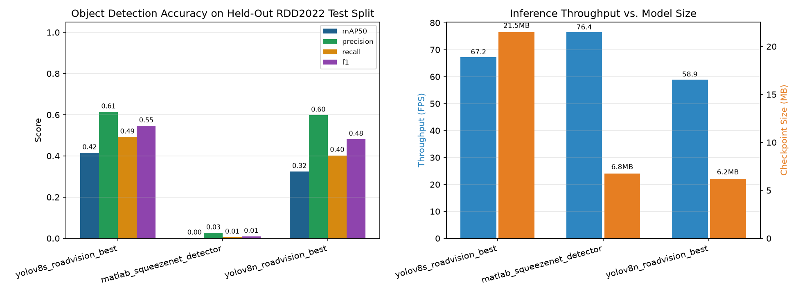

### 16.2 GPU vs. CPU Latency & End-to-End Overhead (`30` India Test Images)

| Execution Mode | YOLOv8s Latency | YOLOv8s FPS | YOLOv8n Latency | YOLOv8n FPS |
| :--- | :---: | :---: | :---: | :---: |
| **GPU (`RTX 4050` batched inference)** | `14.78 ms` | `67.65` | `15.32 ms` | `65.29` |
| **CPU (Intel x64 batched inference)** | `107.15 ms` | `9.33` | `48.31 ms` | `20.70` |
| **MATLAB Single-Image Subprocess Bridge** | `~3.8–4.0 s` | ~0.26 | — | — |
| **MATLAB Batch Video Pipeline (`72` frames)** | `5.349 s` total (`74.3 ms/frame` incl. video I/O + tracking) | **`13.46 FPS`** | — | — |

### 16.3 Cross-Country, Negative-Safety & Stress Scenario Evaluation (`YOLOv8s @ conf = 0.30`)

Evaluated across `80` held-out test images per RDD2022 country, `80` clean negative images, `80` multi-defect scenes, and `50` India test images under synthetic degradations ([scenario_evaluation.json](../reports/scenario_evaluation.json)):

| Scenario / Subset | Images | Precision | Recall | F1 | Clean Negatives Safe / Total | Mean Infer (ms) |
| :--- | :---: | :---: | :---: | :---: | :---: | :---: |
| **China_MotorBike** | `80` | `0.7816` | `0.6326` | **`0.6992`** | `3 / 3` | `10.65` |
| **United_States** | `80` | `0.7161` | `0.6343` | `0.6727` | N/A | `11.54` |
| **China_Drone** | `80` | `0.5867` | `0.4681` | `0.5207` | `22 / 23` | `40.13` |
| **Japan** | `80` | `0.6494` | `0.3704` | `0.4717` | `16 / 19` | `11.00` |
| **India** | `80` | `0.6176` | `0.2658` | `0.3717` | `42 / 44` | `10.50` |
| **Norway** | `80` | `0.6750` | `0.2348` | `0.3484` | `46 / 47` | `35.25` |
| **Czech** | `80` | `0.5385` | `0.1842` | `0.2745` | `47 / 50` | `10.13` |
| **Zero-Defect Clean Roads** | `80` | N/A | N/A | N/A | **`69 / 80` (`86.25%` specificity, `15` FPs)** | `9.55` |
| **Multi-Defect Dense Scenes** | `80` | `0.7687` | `0.5594` | `0.6476` | N/A | `9.93` |
| **Stress: Clear Baseline (India)** | `50` | `0.6190` | `0.2600` | `0.3662` | `28 / 29` | `10.21` |
| **Stress: Low Resolution (`3×` down)** | `50` | `0.6471` | `0.2200` | `0.3284` | `27 / 29` | `10.33` |
| **Stress: Low Light (`35%` brightness)** | `50` | `0.5882` | `0.2000` | `0.2985` | `26 / 29` | `10.63` |
| **Stress: Gaussian Blur (`σ`)** | `50` | `0.5000` | `0.0600` | `0.1071` | `28 / 29` | `10.62` |

### 16.4 Pixel-Level Crack Segmentation & Preprocessing Ablation

| Dataset (`50` Test Images Each) | Method | Mean IoU | Mean Dice / F1 | Precision | Recall | Runtime (ms/img) |
| :--- | :--- | :---: | :---: | :---: | :---: | :---: |
| **DeepCrack-test-50** | **`dl_unet`** (Native MATLAB Light-UNet) | **`0.6819`** | **`0.7927`** | `0.7628` | `0.8783` | **`394.2`** |
| **DeepCrack-test-50** | `otsu_morph` (Classical Baseline) | `0.5541` | `0.6410` | — | — | `646.5` |
| **Crack500-test-50** (`max_work_dim=800`) | **`dl_unet`** (Native MATLAB Light-UNet) | **`0.2910`** | **`0.4250`** | `0.4748` | `0.5271` | **`530.0`** |
| **Crack500-test-50** (`max_work_dim=800`) | `otsu_morph` (Classical Baseline) | `0.0508` | `0.0939` | — | — | `1296.0` |
| **CFD-50** (Unseen Cross-Domain) | **`dl_unet`** (Native MATLAB Light-UNet) | **`0.1489`** | **`0.2141`** | `0.3280` | `0.1855` | **`191.3`** |
| **CFD-50** (Unseen Cross-Domain) | `otsu_morph` (Classical Baseline) | `0.0984` | `0.1737` | — | — | `410.9` |
| **Pothole600-20** (Crack Threshold Sanity) | `otsu_morph` (Unsupervised) | `0.0673` | `0.1261` | `0.0676` | `0.9535` | `354.4` |

**Preprocessing Ablation (DeepCrack-20):** `bilateral_clahe` increases edge preservation by `8.56×` and contrast gain by `2.22×` (`0.5177` SSIM, `584.9 ms`), whereas `heavy_gaussian` collapses edge strength to `0.1472×` (`0.6612` SSIM), verifying why edge-preserving filtering is required for hairline crack visibility.

### 16.5 End-to-End Video Tracking Benchmark (`reports/roadvision_india_demo.avi`)

Running `processRoadVideo.m` on a `72`-frame (`10 FPS`) Indian road sequence completed batched YOLOv8s GPU detection, Kalman motion prediction, Hungarian IoU association, and annotated AVI serialization in **`5.349 s` (`13.46 FPS` end-to-end, exceeding the `10 FPS` source rate)**, deduplicating **`25` frame-level detections into `3` unique tracked `D40` defects**.

---

## 17. Results and Discussion

1. **Multi-Scale Anchor-Free FPN vs. Single-Scale Grid Regression:** Across identical RDD2022 splits, **YOLOv8s** (`mAP@0.5 = 0.4155`, `F1 = 0.5461` at `conf = 0.25`) outperforms **YOLOv8n** (`mAP@0.5 = 0.3242`, `F1 = 0.4811`) by **`+9.13` percentage points** in `mAP@0.5` while retaining real-time GPU throughput (`67.22 FPS` vs. `58.93 FPS`; on CPU, YOLOv8n is **`2.22×` faster** at `20.70 FPS` vs. `9.33 FPS`). In stark contrast, the single-scale `256×256` `8×8`-grid native MATLAB SqueezeNet baseline stalled at `mAP@0.5 = 0.0010` despite monotonic loss reduction (`3.9997 -> 2.5666` train, `3.6205 -> 3.0772` val). Thin pavement cracks (`D00`, `D10`) occupy narrow aspect-ratio regions requiring high-resolution P3 feature pyramids (`80×80` stride-8 grids) and Distribution Focal Loss (`DFL`), validating our architectural decision to pair YOLOv8s for primary multi-scale bounding-box detection with native MATLAB `dlnetwork` for offline fallback and crack pixel segmentation.
2. **Low Inter-Class Confusion vs. Small/Low-Contrast Recall:** The held-out test confusion matrix ([yolov8s_confusion_matrix.png](assets/yolov8s_confusion_matrix.png)) demonstrates strong class separation among detected distresses (diagonal recall `0.49` D00, `0.50` D10, `0.57` D20, `0.39` D40, with inter-class confusion <= `0.02`). Virtually all missed errors fall into the `background` false-negative column (`0.40–0.59`), reflecting faint hairline cracks, harsh glare, and small wide-angle objects — consistent with the lower recall in `India` (`0.2658`), `Norway` (`0.2348`), and `Czech` (`0.1842`) compared to top-down `China_MotorBike` (`F1 = 0.6992`) and `United_States` (`F1 = 0.6727`).
3. **Environmental Stress Sensitivity & Preprocessing Role:** Synthetic stress testing confirms extreme sensitivity to camera defocus/motion blur (`gaussian_blur` recall drops from `0.260` to `0.060`, `F1 = 0.1071`), whereas moderate low-resolution downsampling (`3×`, `F1 = 0.3284`) and low-light attenuation (`35%`, `F1 = 0.2985`) degrade recall more gradually. Importantly, aggressive `bilateral + CLAHE` contrast expansion enhances crack-edge gradients (`8.56×`) for manual UI inspection and morphological crack segmentation, while raw normalized RGB preserves natural texture statistics expected by YOLOv8s.
4. **Learned Light-UNet Segmentation Advantage & ROI Cap Speedup:** On pixel-level crack masks ([segmentation_benchmark_chart.png](assets/segmentation_benchmark_chart.png)), the native MATLAB 3-level Light-UNet (`1.58 MB`, `Val Dice = 0.6121`) substantially outperforms `otsu_morph` across both matched domains (`DeepCrack-test-50`: `0.7927` vs. `0.6410` Dice; `Crack500-test-50`: `0.4250` vs. `0.0939` Dice) and unseen cross-domain imagery (`CFD-50`: `0.2141` vs. `0.1737` Dice). Enforcing `max_work_dim = 800` in [segmentRoadDamage.m](../src/matlab/segmentation/segmentRoadDamage.m) keeps high-resolution `Crack500` (`2560×1440`–`3264×2448`) segmentation around `530 ms/img` (`2.4×` faster than `1,296 ms` `otsu_morph`). Meanwhile, `Pothole600-20` achieves only `0.0673` unsupervised Otsu IoU, empirically confirming why `D40` potholes require bounding-box semantic segmentation rather than dark-pixel thresholding.
5. **Architectural Latency Trade-Off:** Because Windows Smart App Control blocks MATLAB's in-process `pyenv`, single-image interactive detection invokes `infer_yolov8.py` as an isolated subprocess (`~3.8–4.0 s` cold Python/Torch import per click), whereas batching frames (`processRoadVideo.m` and `evaluate_models.py`) amortizes startup once to sustain `13.46 FPS` end-to-end video tracking and `67.22 FPS` GPU inference.

````carousel
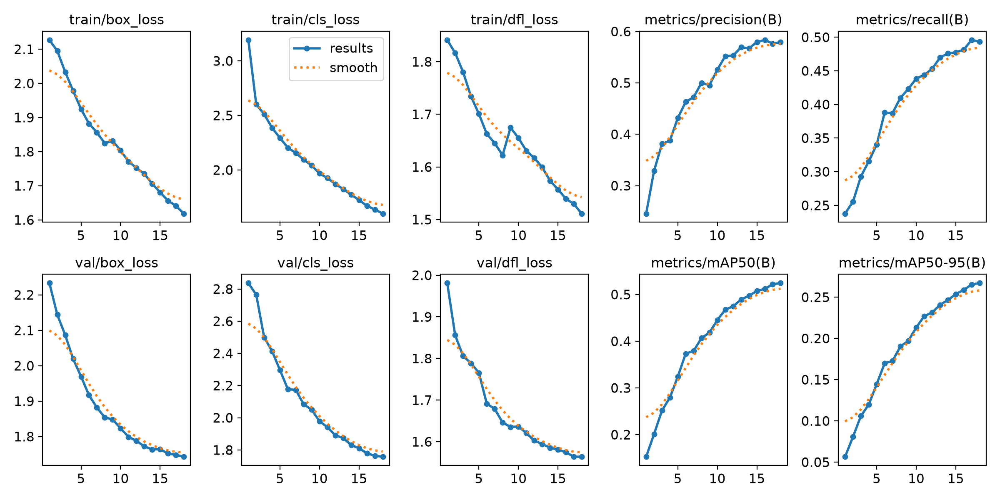
<!-- slide -->
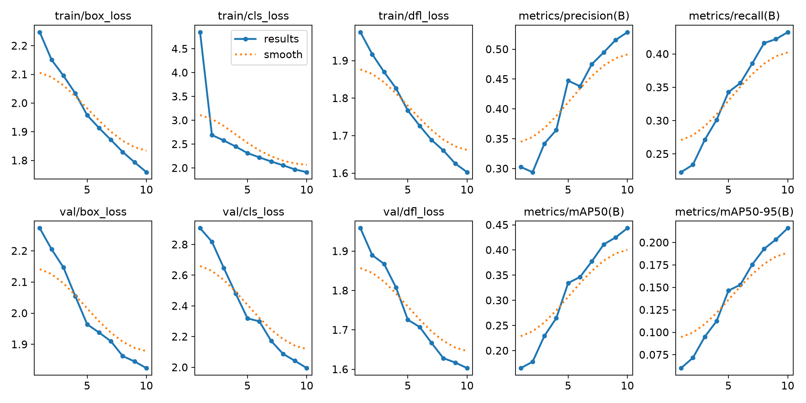
<!-- slide -->
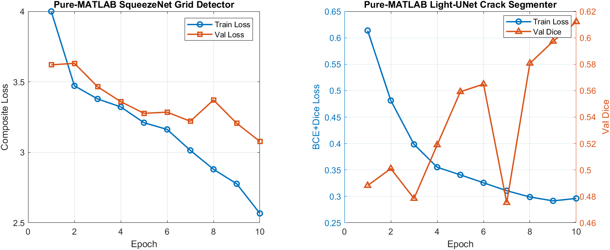
<!-- slide -->
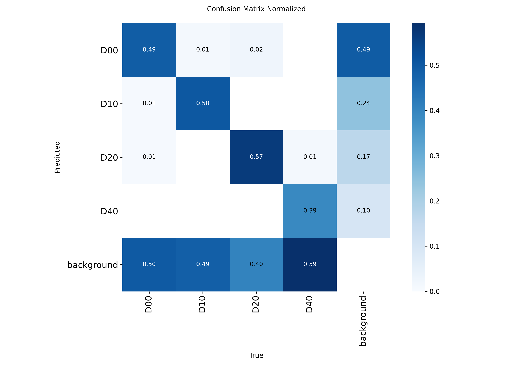
````

````carousel
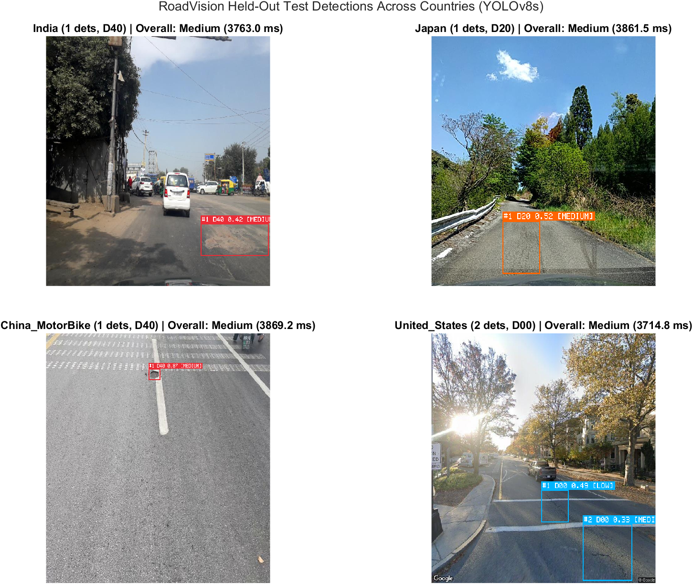
<!-- slide -->
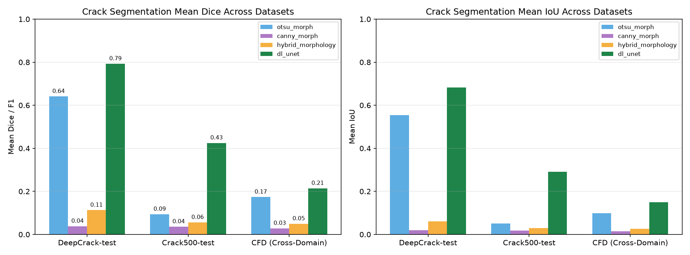
<!-- slide -->
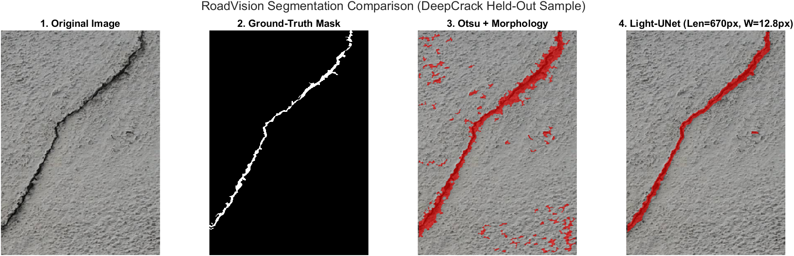
<!-- slide -->
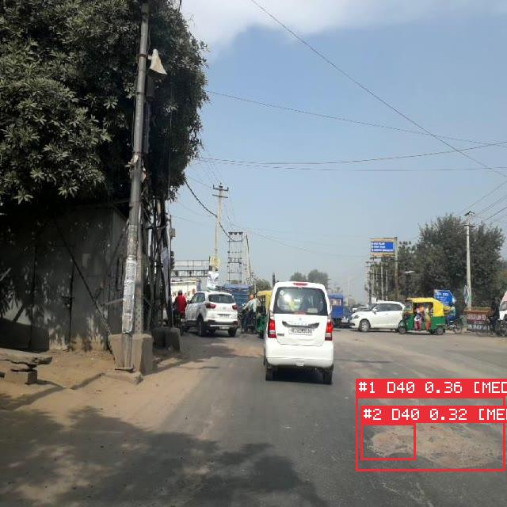
````

````carousel
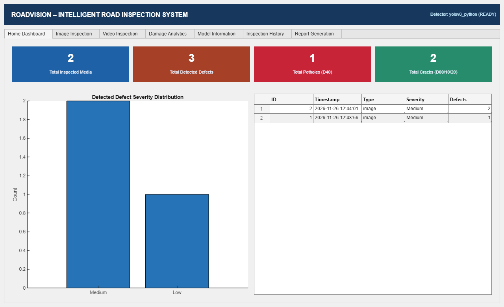
<!-- slide -->
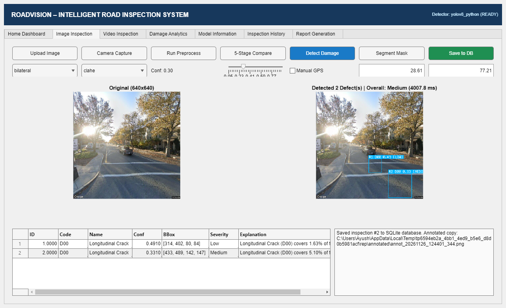
````

---

## 18. Limitations

1. **No Monocular 2D Depth Measurement:** Single 2D RGB images cannot reliably estimate true pothole depth in millimeters; stereo vision, LiDAR, or structured depth sensors are required for volumetric distress severity.
2. **Scale Calibration Requirement:** Pixel area and skeleton length/width convert to physical `cm`/`mm` only when camera calibration (`px_per_cm_calibrated`) or a physical reference target is provided.
3. **Environmental & Domain Shift:** Severe night glare, standing water reflections, mud occlusion, or heavy motion blur (`gaussian_blur` recall `0.060`) degrade both classical segmentation and deep detection recall.
4. **Unsupervised Segmentation Precision:** Threshold/morphological crack segmentation alone generates false positives on dark asphalt aggregate textures and shadows (`Crack500-test-50` `otsu_morph` Dice `0.0939`), demonstrating why bounding-box ROI localization or learned U-Net segmentation (`0.4250` Dice) is preferable.
5. **Host OS Policy Constraints & Cold Subprocess Startup:** Windows 11 Smart App Control restricts several built-in MATLAB MEX libraries (including `pyenv`) on this workstation, requiring pure-MATLAB M-code implementations and subprocess Python workers (`~3.8–4.0 s` startup for isolated single images vs. `13.46 FPS` amortized batch video).

---

## 19. Future Scope

1. Extend the Light-UNet segmentation module with multi-class crack vs. pothole masks (incorporating Pothole-600 disparity maps) and transformer decoders (SegFormer/Swin-UNet).
2. Integrate stereo disparity or depth-camera streams (building on Pothole-600's stereo methodology) to estimate true pothole volume and IRC/ASTM severity ratings.
3. Replace single-image subprocess spawning with a persistent localhost/ZeroMQ Python inference worker so interactive single-image UI clicks drop from `~3.8 s` to `<25 ms`.
4. Add dashboard camera GPS NMEA/GPX time-synchronized ingestion and extend `config/classes.json` with `D50` (manhole/utility covers), `D60` (bleeding/rutting), and faded lane markings.

---

## 20. Conclusion

**RoadVision (`v1.0.0`)** successfully delivers an end-to-end, reproducible intelligent road inspection platform combining pure-MATLAB digital image processing (`5`-stage enhancement pipeline), dual deep-learning object detection (`YOLOv8s` & `YOLOv8n` CUDA + native MATLAB SqueezeNet baseline), native MATLAB `dlnetwork` crack segmentation (`Light-UNet` `0.7927` Dice on `DeepCrack-test-50`), severity triage with transparent monocular disclaimers, Kalman + Hungarian video defect tracking (`13.46 FPS` end-to-end, collapsing `25` frame boxes into `3` unique tracked defects), EXIF/manual GPS visualization, persistent SQLite logging, ReportLab PDF reporting, and a 7-tab MATLAB App Designer desktop GUI. Across **`47,420` RDD2022 images**, **`4,873` pixel-segmentation pairs**, and **`32/32` passing automated MATLAB + Python verification tests**, the system validates both engineering robustness under Windows 11 security constraints and quantitative trade-offs across modern multi-scale object detectors and classical/deep crack segmentation methods.

---

## 21. References

1. Arya, D., Maeda, H., Ghosh, S. K., Toshniwal, D., & Sekimoto, Y. (2024). *RDD2022: A multi-national image dataset for automatic road damage detection*. Geoscience Data Journal, 11(4), 846–862.
2. Arya, D., Maeda, H., Ghosh, S. K., Toshniwal, D., Omata, H., Kashiyama, T., & Sekimoto, Y. (2022). *Crowdsensing-based Road Damage Detection Challenge (CRDDC'2022)*. IEEE BigData, 6378–6386.
3. Maeda, H., Sekimoto, Y., Seto, T., Kashiyama, T., & Omata, H. (2018). *Road damage detection and classification using deep neural networks with smartphone images*. Computer-Aided Civil and Infrastructure Engineering, 33(12), 1127–1141.
4. Shi, Y., Cui, L., Qi, Z., Meng, F., & Chen, Z. (2016). *Automatic road crack detection using random structured forests*. IEEE Transactions on Intelligent Transportation Systems, 17(12), 3434–3445.
5. Liu, Y., Yao, J., Lu, X., Xie, R., & Li, L. (2019). *DeepCrack: A deep hierarchical feature learning architecture for crack segmentation*. Neurocomputing, 338, 139–153.
6. Yang, F., Zhang, L., Yu, S., Prokhorov, D., Mei, X., & Ling, H. (2019). *Feature pyramid and hierarchical boosting network for pavement crack detection*. IEEE Transactions on Intelligent Transportation Systems, 21(4), 1525–1535.
7. Fan, R., Wang, H., Bocus, M. J., & Liu, M. (2020). *We learn better road pothole detection: From attention aggregation to adversarial domain adaptation*. ECCV Workshops, 285–300.
8. Jocher, G., Chaurasia, A., & Qiu, J. (2023). *Ultralytics YOLOv8*. GitHub Repository.
9. MathWorks (2024). *MATLAB R2024a Image Processing, Computer Vision, and Deep Learning Toolboxes Documentation*.
